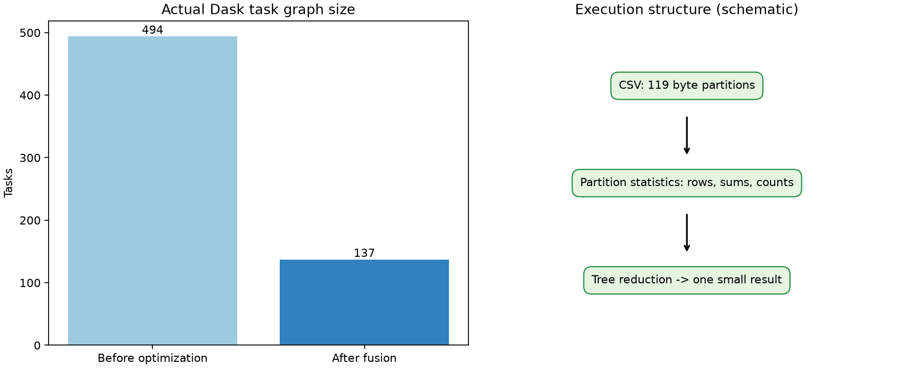
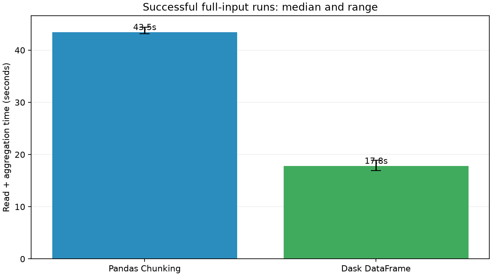
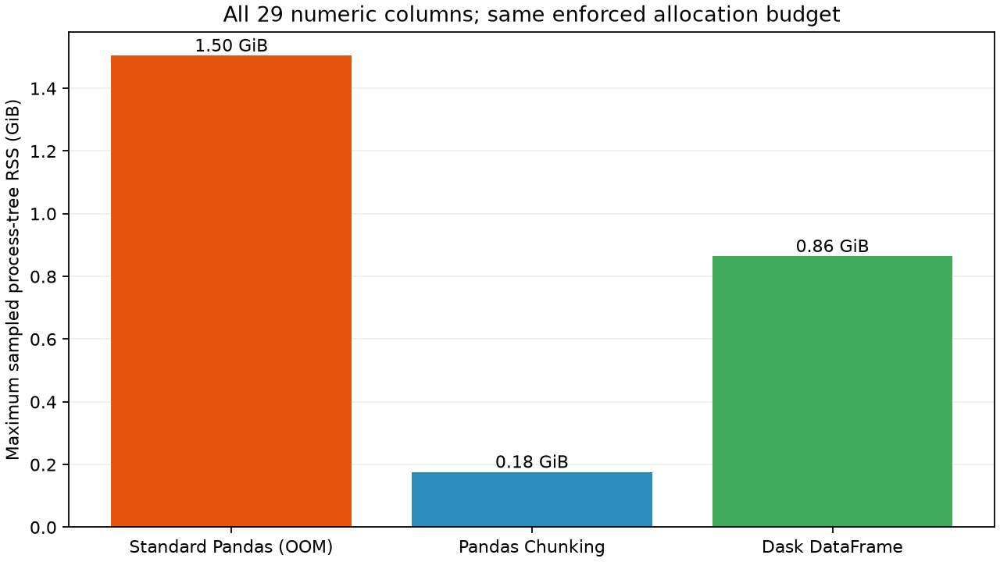
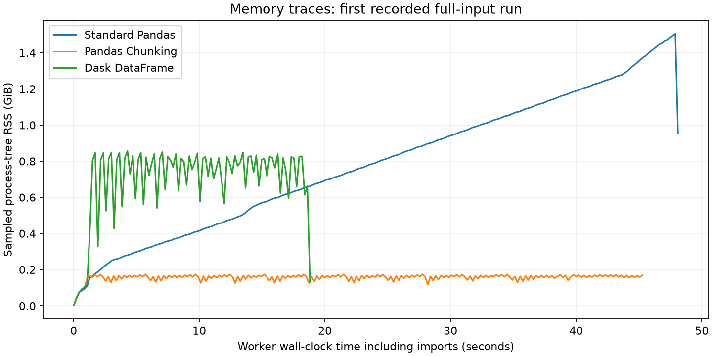

# تقرير TP02: معالجة بيانات إدخال أكبر من 5GB

جامعة الوادي، ماستر ثانية IA & Data Science، Big Data Analytics، السنة 2026/2027.

## البيانات ودليل الحجم

استخدمنا **HIGGS** الكاملة من [نسخة Kaggle](https://www.kaggle.com/datasets/erikbiswas/higgs-uci-dataset)، إصدار 1. [المصدر الأصلي UCI](https://archive.ics.uci.edu/dataset/280/higgs) يصف 11 مليون حدث محاكاة فيزياء: تصنيف label و28 خاصية عددية. نعتمد رخصة المصدر الأصلي CC BY 4.0 وننسب البيانات إلى Daniel Whiteson وورقة Baldi وSadowski وWhiteson (2014)، حتى إن عرضت النسخة المرآة رخصة مختلفة.

- الإدخال: data/raw/HIGGS.csv.
- حجم CSV الفعلي: **8,035,497,980 بايت = 8.035GB = 7.484GiB**.
- حجم الأرشيف: **2,902,133,066 بايت = 2.902GB**.
- السجلات المنطقية التي أحصاها قارئ CSV: **11,000,000**. الملف دون ترويسة.
- الأعمدة: **29**.
- CRC للعضو داخل ZIP تحقق بقراءته حتى النهاية. SHA-256 للـCSV: `9a7cf07203c2e348a261920a80179e42024b8c43cc6e39d4c42a7b0aa8114815`.

ملف data/manifest.json يضم المصدر والحجم والبصمات وأسماء الأعمدة المعرّفة صراحةً في dataset.py. البصمة تعرّف النسخة المحلية ولا تستبدل checksum ناشر إن لم ينشره. شرط 5GB يخص **الإدخال**؛ النتائج تجميعات صغيرة. العينة الصغيرة اختبرت صحة التنفيذ ولم تستبدل البيانات الكاملة.

ملف ZIP أصغر من 5GB لأن الضغط يقلل الحجم؛ ملف CSV الذي نقرأه يتجاوز حتى 5GiB. نص التكليف يقول قراءة dataset أكبر من 5GB بواسطة pd.read_csv ولا يحدد حدًا لحجم ZIP.

## البيئة والقياس

النظام `Windows-11-10.0.26200-SP0`، Python 3.13.7، RAM نحو 31.85GiB، 10 أنوية فيزيائية و16 معالجًا منطقيًا.

الإصدارات: pandas 3.0.6, dask 2026.8.0, distributed 2026.8.0, psutil 7.2.2, matplotlib 3.11.2, pyarrow 26.0.0, numpy 2.5.4. requirements.txt يثبت جميع الإصدارات.

كل الطرق تقرأ **كل الأعمدة الـ29** بنفس النوع float64 لكل الأعمدة، وتجميع أربعة أعمدة عددية هي label وlepton_pt وm_jj وm_wwbb. نفس التجميعات تطبق على كل السجلات، ولا نتخطى الأسطر المعطوبة.

تستخدم التجارب **ميزانية تخصيص للعملية قدرها 2.0GiB** مفروضة بواسطة Windows Job Object. هذا حد للذاكرة الملتزمة/التخصيص، وليس نفس قيمة RSS. الجهاز نفسه لديه ذاكرة أكبر؛ النتائج تصف البيئة المحددة ولا تثبت أن التحميل يفشل دون حد أو على كل جهاز.

الزمن التشغيلي للقراءة والتجميع يقاس بعد الاستيراد؛ الزمن الكامل محفوظ كذلك. قمة RSS معاينة كل 0.2 ثانية وتشمل الاستيراد. قد تفوت قمم أقصر من الفاصل. جمع RSS للأبناء قد يحسب صفحات مشتركة أكثر من مرة؛ التنفيذ عامل Python واحد مع threads؛ قد يضيف Windows عملية launcher صغيرة.

لم نفرغ cache نظام الملفات. ترتيب الطرق يتبدل عبر التكرارات؛ النتائج cache مختلط/متكرر وليست cold-cache مضبوطة. التنزيل وفك الضغط خارج زمن التجميع.

CSV بلا ترويسة؛ header=None وnames=COLUMNS يمنعان إسقاط أول سجل. لا نكرر الصفوف ولا نضيف padding لبلوغ الحجم المطلوب.

## Task 1: القراءة التقليدية

استدعاء pd.read_csv على كل الملف دفعة واحدة. ظهر استثناء تخصيص ذاكرة فعلي `MemoryError` أثناء محاولة pd.read_csv تحميل الملف كاملًا. التتبّع محفوظ في results/full/full_run1.log وJSON.

اختُبرت آلية الحد بتخصيص معروف الحجم وأنتجت MemoryError فعليًا. لا نفتعل الخطأ ولا نستهلك معظم RAM الجهاز. guard أو timeout لا يصنف تلقائيًا OOM.

## Task 2: Pandas Chunking

chunksize=100,000 بالضبط. عدد الأجزاء **110** وأكبر جزء **100,000** سطر. يحرر الجزء بعد حساب إحصاءاته، ولا يعاد تكوين الجدول الكامل.

المتوسط = المجموع / عدد القيم الصالحة، لا متوسط متوسطات الأجزاء. نستخدم math.fsum لمجاميع الأجزاء ونحتفظ فقط بإحصاءات صغيرة لكل جزء.

## Task 3: Dask والتحسين

dd.read_csv ينشئ **119 partitions** بحجم blocksize=64MiB. الحجم بالبايت ويختلف عن chunksize بالأسطر. الإنشاء قد يقرأ عينة وmetadata، والمسح الكامل يحدث عند compute.

كل partition يتحول إلى إحصاءات صغيرة ثم تجميع شجري split_every=8. المقاييس تنفذ ضمن رسم واحد. query.optimize(fuse=True) خفض الرسم من **494** إلى **137** مهمة. التنفيذ threaded scheduler بعدد 4 threads. لا نحمل كامل الجدول بـddf.compute ولا persist.

نحافظ على قراءة كل الأعمدة للمقارنة العادلة؛ إسقاط الأعمدة ليس مختلطًا مع هذه التجربة. التعبيرات وأعداد المهام وعينة الاعتماديات في results/full/dask_graph.json.

## النتائج الفعلية

| الطريقة | الحالة | محاولات مسجلة | زمن القراءة والتجميع | أكبر RSS معاين |
| --- | --- | --- | --- | --- |
| Standard Pandas | oom / MemoryError | 1 | 47.06 ثانية حتى الفشل؛ ليس زمن نجاح | 1.504GiB |
| Pandas Chunking | نجاح | 3 | 43.46 ثانية، المدى 43.14-44.38 | 0.176GiB |
| Dask DataFrame | نجاح | 3 | 17.84 ثانية، المدى 16.94-18.89 | 0.864GiB |

زمن OOM هو زمن حتى الفشل وليس زمن نجاح؛ لا نحسب speedup مقابل محاولة فاشلة. تفوق Dask يستنتج من القياس ولا يفترض من جدول التكليف.

متوسط label يمثل نسبة الأحداث ذات الفئة 1، وليس دقة نموذج تصنيف. لا يتطلب هذا TP تدريب نموذج.

## صحة النتائج

العدد المنطقي 11,000,000 يطابق عدد الأسطر المادية: 11 مليون سجل دون ترويسة. تطابقت النتائج عبر **6 محاولات ناجحة** بسماحية relative 1e-9 وabsolute 1e-6 بسبب ترتيب جمع float64.

| العمود | صالح | مفقود | المجموع | المتوسط |
| --- | --- | --- | --- | --- |
| label | 11,000,000 | 0 | 5829123 | 0.529920273 |
| lepton_pt | 11,000,000 | 0 | 10906124.3 | 0.991465844 |
| m_jj | 11,000,000 | 0 | 11377193.3 | 1.0342903 |
| m_wwbb | 11,000,000 | 0 | 10557931.9 | 0.959811988 |

نجحت ستة اختبارات: الأجزاء غير المتساوية والقيم المفقودة، تطابق الطرق عبر عدة partitions، رفض نتيجة خاطئة، رفض عمود مطلوب مفقود، عمود كله مفقود، وإنفاذ حد الذاكرة. عينة البيانات الفعلية ذات 100,003 سجل تطابقت فيها الطرق الثلاث أيضًا. نتائجها منفصلة في results/sample.

## مطابقة التكليف

| المطلب | الدليل |
| --- | --- |
| بيانات إدخال أكبر من 5GB | CSV وdata/manifest.json |
| القراءة التقليدية وتوثيق النتيجة | worker.py وسجل full_run1 |
| chunks من 100,000 وتجميع تراكمي | pipeline.py ونتائج chunks |
| Dask والتقييم الكسول وتحسين الرسم | pipeline.py وdask_graph.json والرسم |
| الزمن واستهلاك RAM | benchmark.csv وملفات الذاكرة والرسوم |
| تشغيل قابل للإعادة | README.md وrequirements.txt |
| رفع العمل إلى GitHub | حالة وروابط النشر الفعلية في SUBMISSION_AR.md |

البيانات والبيئة والملفات المؤقتة لا تدخل تاريخ Git. البيانات المضغوطة مقسمة إلى أجزاء <=1GiB لإرفاقها في Release تابع للمستودع نفسه، مع بصمات لإعادة التجميع. جميع الملفات المحلية داخل المشروع على E. توليد التقرير لا يعني اكتمال النشر.
